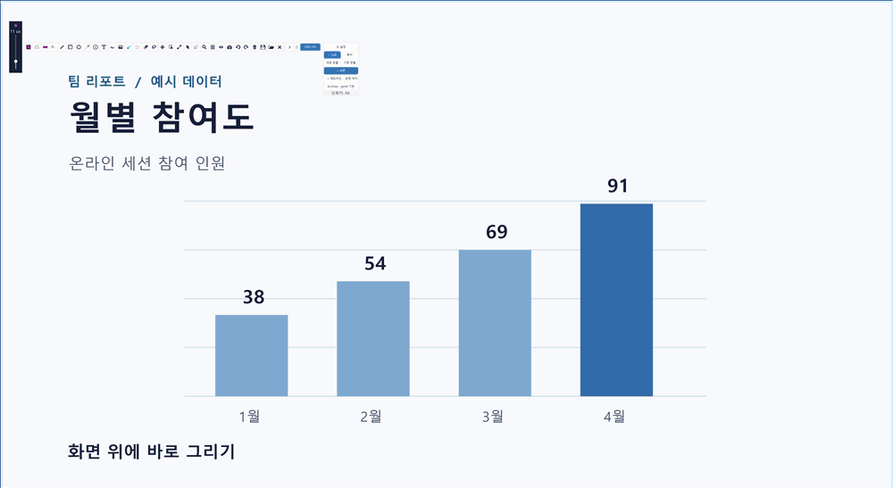
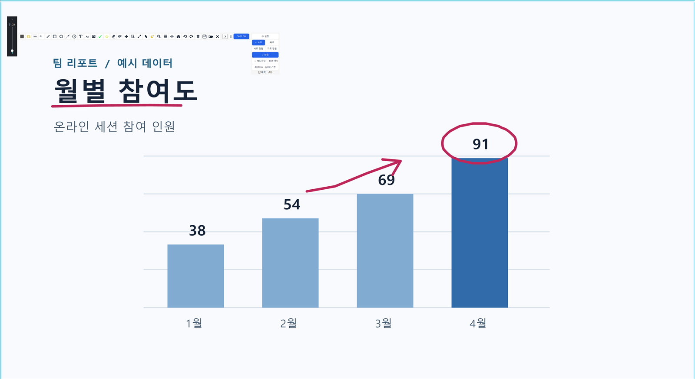
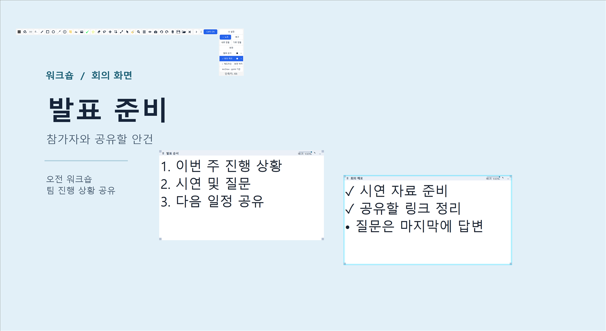

# ArcDraw

ArcDraw는 **지금 보고 있는 Windows 화면 위에 바로 그리거나 글을 쓰는 무료 도구**입니다. 화상회의에서 화면을 설명하거나 강의와 발표에 주석을 달 수 있습니다. 화이트보드 노트, 발표 제목이나 자막을 띄우는 헤드라인, 화면 가장자리를 꾸미는 액자도 제공합니다.

[모든 버전](https://github.com/gamzagui-collab/ArcDraw/releases) · [버전별 변경 사항](CHANGELOG.md)

## 실제 사용 화면

### 화면 위에 그리기

다른 앱에 열어 둔 보고서 위에 펜으로 표시하고, 화살표로 설명할 부분을 가리킵니다.

### 화이트보드 노트

발표 순서와 회의 메모를 별도 노트에 적고, 설명 중인 화면 옆에 띄울 수 있습니다.

### 화면 액자

방송 대기 화면에 사이버펑크 테마를 적용한 모습입니다. 상단 중앙에는 액자를 끄는 단축키가 표시됩니다.

## 처음 사용하기

1. 릴리스의 **ArcDraw-v버전-windows-x86.zip**을 새 폴더에 모두 풀고 **ArcDraw.exe**를 실행합니다.
2. 화면의 ArcDraw 아이콘을 누르거나 **Ctrl+Alt+G**로 툴바를 엽니다.
3. **Caps Lock**을 켜면 그리기와 노트 조작을 시작할 수 있습니다. 끄면 Windows 화면을 평소처럼 조작할 수 있습니다. 툴바가 열려 있을 때 **Alt**를 누르고 있으면 도구 단축키가 표시됩니다.

## 할 수 있는 일

| 기능 | 사용 예 |
| --- | --- |
| 화면에 필기 | 다른 앱을 보면서 펜, 직선, 도형, 화살표, 텍스트, 클립아트로 설명합니다. |
| 화이트보드 노트 | 화면 한쪽에 독립된 노트를 열어 메모하거나 그립니다. 노트 내용은 자동 저장됩니다. |
| 헤드라인 | 발표 제목이나 방송 자막을 화면에 띄웁니다. 120종의 프레임에서 고르고 테두리와 배경색을 따로 바꿀 수 있습니다. |
| 화면 액자 | 110종의 내장 테마를 고르거나 가운데가 투명한 PNG를 가져옵니다. 원본 해상도를 확인하고 일반 창이 액자 안쪽까지만 최대화되도록 작업 영역을 확보할 수 있습니다. |
| 툴바 꾸미기 | 툴바 배치와 크기, 도구, 펜 프리셋, 단축키를 설정합니다. |

[사용설명서](docs/USER_GUIDE_KO.md) · [단축키](docs/SHORTCUTS_KO.md) · [라이선스와 원본 고지](docs/LICENSE_KO.md)

## 업데이트

ArcDraw 트레이 메뉴에서 **업데이트 확인…**을 선택하거나 [최신 릴리스](https://github.com/gamzagui-collab/ArcDraw/releases/latest)에서 ZIP을 받으세요. 이전 버전은 [릴리스 목록](https://github.com/gamzagui-collab/ArcDraw/releases)에서 받을 수 있습니다. 배포 ZIP과 SHA-256 파일은 각 릴리스의 **Assets**에 있습니다.

## 원본 프로젝트

ArcDraw는 Weizhi Nai의 [gInk](https://github.com/geovens/gInk)와 Pubpub-ZZ의 [ppInk](https://github.com/pubpub-zz/ppInk)를 기반으로 합니다. [원본 MIT 라이선스](LICENSE-ppInk-gInk.txt) · [개발자 고지](ArcDraw_NOTICES.txt) · [제3자 라이선스 안내](THIRD_PARTY_NOTICES.md)
